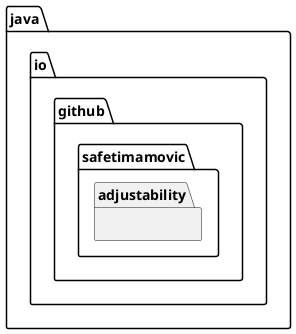

# Class Diagrams

## What are Class Diagrams?

[Wikipedia Article](https://en.wikipedia.org/wiki/Class_diagram)

A **UML (Unified Modeling Language)** class diagram is a type of static structure diagram
that describes the structure of a system by showing its classes, their attributes,
methods, and the relationships among objects. In the context of Adjustability,
UML class diagrams can be particularly useful because they can visually represent the
design of the mod.

## Access Modifier Notation

Characters that define the visibility:

| Character | Icon for field | Icon for method | Visibility        |
|-----------|----------------|-----------------|-------------------|
| `-`       | &#9723;        | &#9724;         | `private`         |
| `#`       | &#9671;        | &#9670;         | `protected`       |
| `~`       | &#9651;        | &#9650;         | `package private` |
| `+`       | &#9675;        | &#9679;         | `public`          |

Every mod specific class will have a `MODID` field that is `public` and `final` which is defined in the
main `Adjustability` java file.

Also all of the classes are within the `java.io.github.safetimamovic.adjustability` package:

