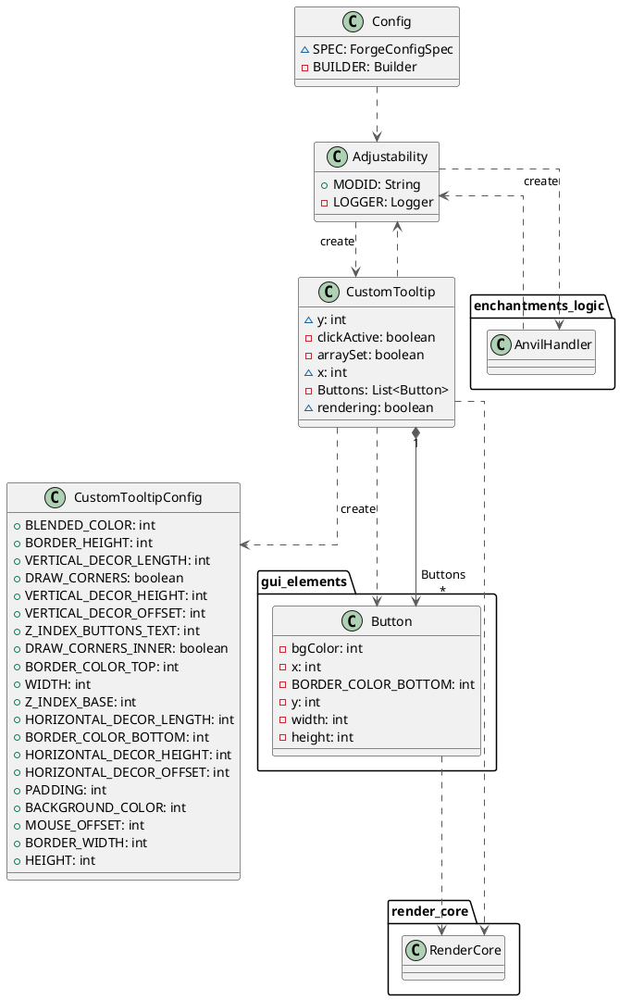

# Data Only Class Diagram

<chapter collapsible="true" title="Access Modifier Notation">
<p>Characters that define the visibility:</p>
<table>
<tr><th>Character</th><th>Icon for field</th><th>Icon for method</th><th>Visibility</th></tr>
<tr><td><code>-</code></td><td>&#9723;</td><td>&#9724;</td><td><code>private</code></td></tr>
<tr><td><code>#</code></td><td>&#9671;</td><td>&#9670;</td><td><code>protected</code></td></tr>
<tr><td><code>~</code></td><td>&#9651;</td><td>&#9650;</td><td><code>package private</code></td></tr>
<tr><td><code>+</code></td><td>&#9675;</td><td>&#9679;</td><td><code>public</code></td></tr>
</table>
</chapter>



<chapter collapsible="true" title="Plain PlantUML Text">
```text
@startuml
    top to bottom direction
    skinparam linetype ortho

    class Adjustability {
    + MODID: String
    - LOGGER: Logger
    }
    package enchantments_logic
    {
    class AnvilHandler {
    }
    }

    package gui_elements
    {
    class Button {
    - bgColor: int
      - x: int
      - BORDER_COLOR_BOTTOM: int
      - y: int
      - width: int
      - height: int
    }
    }
    
    class Config {
    ~ SPEC: ForgeConfigSpec
    - BUILDER: Builder
      }
      class CustomTooltip {
      ~ y: int
      - clickActive: boolean
      - arraySet: boolean
        ~ x: int
      - Buttons: List<Button>
        ~ rendering: boolean
        }
        class CustomTooltipConfig {
      + BLENDED_COLOR: int
      + BORDER_HEIGHT: int
      + VERTICAL_DECOR_LENGTH: int
      + DRAW_CORNERS: boolean
      + VERTICAL_DECOR_HEIGHT: int
      + VERTICAL_DECOR_OFFSET: int
      + Z_INDEX_BUTTONS_TEXT: int
      + DRAW_CORNERS_INNER: boolean
      + BORDER_COLOR_TOP: int
      + WIDTH: int
      + Z_INDEX_BASE: int
      + HORIZONTAL_DECOR_LENGTH: int
      + BORDER_COLOR_BOTTOM: int
      + HORIZONTAL_DECOR_HEIGHT: int
      + HORIZONTAL_DECOR_OFFSET: int
      + PADDING: int
      + BACKGROUND_COLOR: int
      + MOUSE_OFFSET: int
      + BORDER_WIDTH: int
      + HEIGHT: int
        }
        package render_core
        {
        class RenderCore {
        }
      }
    
    Adjustability        -[#595959,dashed]->  AnvilHandler        : "«create»"
    Adjustability        -[#595959,dashed]->  CustomTooltip       : "«create»"
    AnvilHandler         -[#595959,dashed]->  Adjustability       
    Button               -[#595959,dashed]->  RenderCore          
    Config               -[#595959,dashed]->  Adjustability       
    CustomTooltip        -[#595959,dashed]->  Adjustability       
    CustomTooltip        -[#595959,dashed]->  Button              : "«create»"
    CustomTooltip       "1" *-[#595959,plain]-> "Buttons\n*" Button              
    CustomTooltip        -[#595959,dashed]->  CustomTooltipConfig
    CustomTooltip        -[#595959,dashed]->  RenderCore
@enduml
```
</chapter>