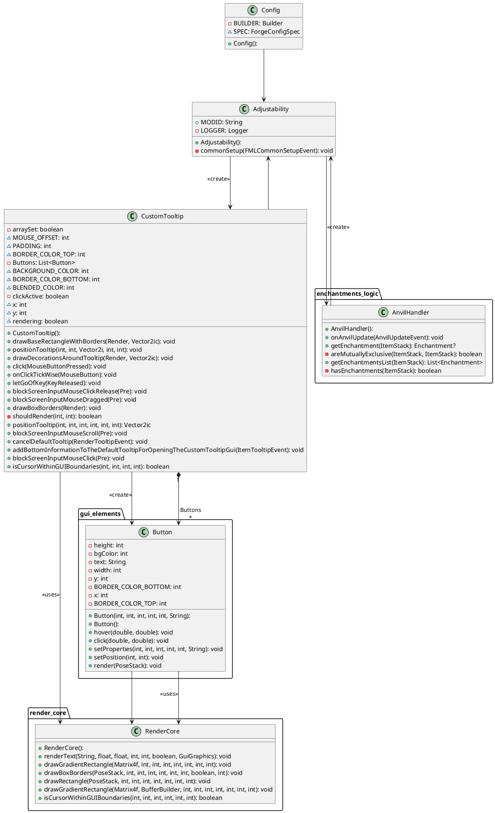

# Full Class Diagram

<chapter collapsible="true" title="Access Modifier Notation">

Characters that define the visibility:

<table>
<tr><th>Character</th><th>Icon for field</th><th>Icon for method</th><th>Visibility</th></tr>
<tr><td><code>-</code></td><td>&#9723;</td><td>&#9724;</td><td><code>private</code></td></tr>
<tr><td><code>#</code></td><td>&#9671;</td><td>&#9670;</td><td><code>protected</code></td></tr>
<tr><td><code>~</code></td><td>&#9651;</td><td>&#9650;</td><td><code>package private</code></td></tr>
<tr><td><code>+</code></td><td>&#9675;</td><td>&#9679;</td><td><code>public</code></td></tr>
</table>
</chapter>

