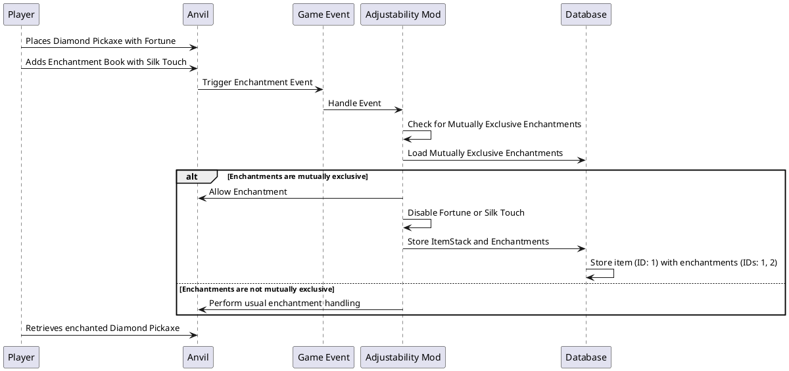
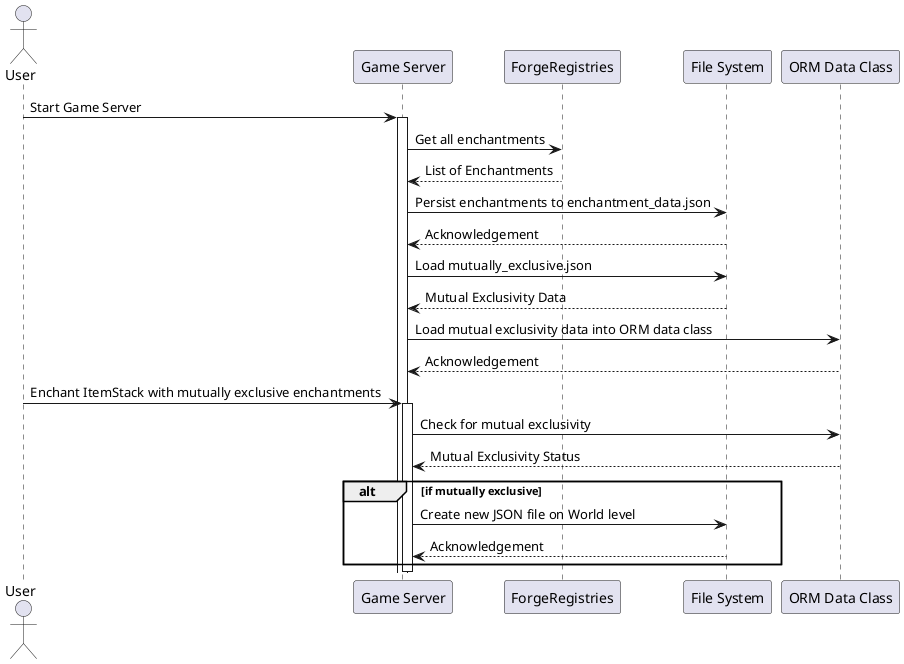

# Mechanics

## Main Functionality

**Adjustability**'s main functionality is to enable the Player to toggle between **Mutually Exclusive Enchantments**   of an **Item** (**ItemStack** Class), of course if that particlar item meets that condition.

<procedure title="Example">

If an item, for instance Diamond Pickaxe, is enchanted with 2 Mutually Exclusive Enchantments, let's say **Fortune III** and **Silk Touch**, the mod should have a mechanism which chooses one of those Enchantments (More details on how that's chosen later) to be active on the item (because Mutually Exclusive Enchantments shouldn't stack).

So, some sort of _ItemStack.disable(Enchantment e)_ or _Enchantment.disable(ItemsStack i)_ method would be really helpful.

The issue is the way **Minecraft** and the **Forge API** handle Enchantments.

</procedure>


## Default Enchantment Handling

Now, there isn't anything inherently wrong with the way Enchantments are handled by default, all of the **EnchantmentHandler** methods do their job as intended, but for the purposes of **Adjustability** it leaves a lot to be desired.

If you wanted to '_disable_' an enchantment on an item, there's no direct way of doing that. The **EnchantmentHandler** class doesn't provide such methods. Instead, if you wanted '_disable_' a certain enchantment you would need to completely remove that enchantment from the item, essentially '_disabling_' it.


Now, You might think:

'Why don't you just create a custom enchantment class that inherits from the existing **Enchantment** class and implement that funcionality?'

I don't like that solution because then the mod would have to copy over the objects from the **Enchantment** class and instatiate objects based off of my **CustomEnchantment** class. This just adds unecessary object's onto the memory and creates a middle-man between enchantable entities and base enchantments.

The approach is to come up with the least invasive way to handle data.

One way, which is actually pretty invasive, is to persist the Mutually Exclusive Enchantment data again to the **ItemStack** NBT data.

**ItemStack** `ComponentData`
```
{enchantments: [
    {silk_touch},
    {fortune},
    {efficiency}
  ]
}

...rest of the nbt data...

+  {enchantments: [
+      {silk_touch},
+      {fortune}
+    ]
+  }
```

Then this **ItemStack** will persist the data that's necessary for **Adjustability**.

The downside is of course that this approach is very invasive, because this data is persisted at the vanilla level. Meaning that if a player removes **Adjustability**.jar file, the additional enchantment data will be persisted forever.


## Solution

The way most other mods handle data is by persisting data in their own custom directories, creating a custom database.

This is the approach that was chosen because:
- Non-invasive - No vanilla data is affected

This is possible because each **ItemStack** object has a unique identifier (it's not universally unique like a UUID, it's unique in the context of the server/game instance), we can make entries to our custom '_table_' which stores the different mutually exclusive enchantments based off of the **ItemStack** it's asosciated with.

**Adjustability** essentially splits every **ItemStack** object into 2 distinct categories:
- **ItemStack** objects with Mutually Exclusive Enchantments
- **ItemStack** objects without Mutually Exclusive Enchantments

<procedure title="Practical Example of an ItemStack reaching the Mutually Exclusive ItemStack Category">
<step>
    There exists a <strong>Diamond Pickaxe</strong> with exactly <strong>1</strong> Enchantment:
    <ol>
        <li><strong>Fortune</strong></li>
    </ol>
</step>
<step>
    The <strong>ItemStack</strong> object for this <strong>Diamond Pickaxe</strong> will have a unique identifier, let's say <strong>1</strong>.
</step>
<step>
    The player then places that Diamond Pickaxe with <strong>Fortune</strong> in the left slot of the <strong>Anvil</strong> and an Enchantment book with only <strong>Silk Touch</strong> on it in the Anvil's right slot.
</step>
<step>
    The vanilla enchantment mechanics block the action of combining Enchantments from these ItemStacks because <strong>Fortune</strong> and <strong>Silk Touch</strong> are Mutually Exclusive Enchantments.
</step>
<step>
    The action of placing an item in the <strong>Anvil</strong> is a <strong>Game Event</strong>. This Event can be targeted by a custom method with the @EventSubscriber annotation.
    
</step>
<step>
    Using the Event, a custom method can check if combining the two items would result in an ItemStack with Mutually Exclusive Enchantments.
    It checks against a Data Class which stores the Mutually Exclusive Enchantments and their relations (this is loaded into memory from persisted storage).
</step>
<step>
    In this example, this process would result in a Diamond Pickaxe with <strong>Fortune</strong> and <strong>Silk Touch</strong>, which are Mutually Exclusive Enchantments.
    Because this ItemStack would reach the Mutually Exclusive ItemStack Category, it's data related to the mod would be stored in a custom database.
</step>
<step>
    The ItemStack with the unique identifier <strong>1</strong> would be stored in a custom database, alongside entries for it's Mutually Exclusive Enchantments.
</step>
<step>
    Using the Event, the method can intercept the event and apply the Mutually Exclusive Enchantment anyway.
</step>

<step>
    Now there exists a <strong>Diamond Pickaxe</strong> with <strong>2</strong> Mutually Exclusive Enchantments:
    <ol>
        <li><strong>Silk Touch</strong></li>
        <li><strong>Fortune</strong></li>
    </ol>
</step>
<step>
    Suppose that these 2 enchantment have a unique identifier of <strong>1</strong> and <strong>2</strong> respectively.
    The ItemStack with the unique identifier <strong>1</strong> would be stored in a custom database, alongside entries for it's Mutually Exclusive Enchantments. This 'file' will be present at the World level:
    <code-block>
    <![CDATA[
    1: [1, 2]
    ]]>
    </code-block>
</step>

</procedure>



