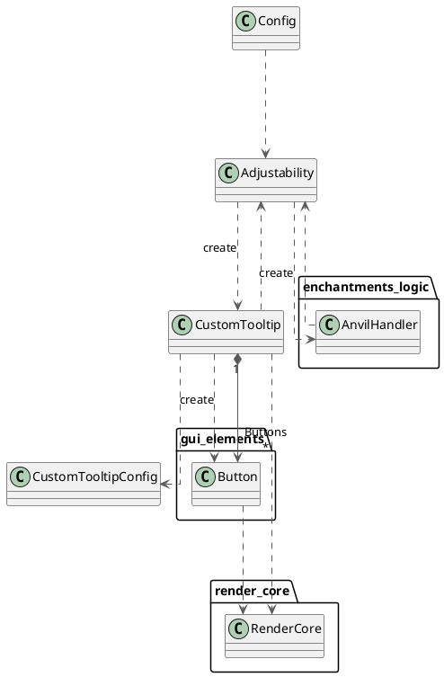

# Structural/Name Only Class Diagram



<chapter collapsible="true" title="Plain PlantUML Text">
```text
@startuml
    top to bottom direction
    skinparam linetype ortho
    class Adjustability
    package enchantments_logic
    {
        class AnvilHandler
    }
    package gui_elements
    {
        class Button
    }
    class Config
    class CustomTooltip
    class CustomTooltipConfig
    package render_core
    {
    class RenderCore
    }

    Adjustability        --[#595959,dashed]->  AnvilHandler        : "«create»"
    Adjustability        --[#595959,dashed]->  CustomTooltip       : "«create»"
    AnvilHandler         --[#595959,dashed]->  Adjustability       
    Button               --[#595959,dashed]->  RenderCore          
    Config               --[#595959,dashed]->  Adjustability       
    CustomTooltip        --[#595959,dashed]->  Adjustability       
    CustomTooltip        --[#595959,dashed]->  Button              : "«create»"
    CustomTooltip       "1" *--[#595959,plain]-> "Buttons\n*" Button              
    CustomTooltip        --[#595959,dashed]->  CustomTooltipConfig
    CustomTooltip        --[#595959,dashed]->  RenderCore

@enduml

```
</chapter>

