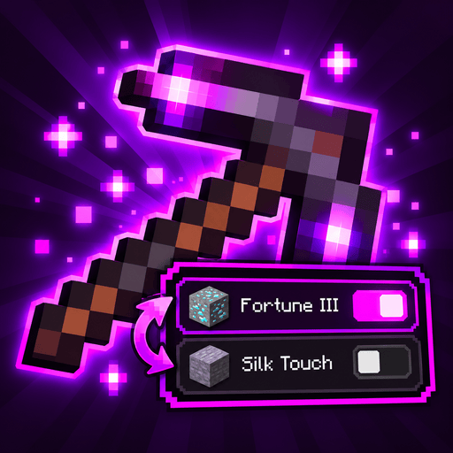

<p align="center">
  
</p>

<h1 align="center">Adjustability</h1>

<p align="center">
  Put Fortune and Silk Touch on the same pickaxe, and switch between them. Items hold mutually exclusive enchantments;
  one side of each conflict is active at a time, never both.
</p>

<p align="center">
  <a href="https://github.com/SafetImamovic/Adjustability/actions/workflows/build.yml"></a>
  <a href="https://github.com/SafetImamovic/Adjustability/releases"></a>
  <a href="https://safetimamovic.github.io/Adjustability/"></a>
  <a href="LICENSE"></a>
</p>

<p align="center">
  <a href="https://github.com/SafetImamovic/Adjustability/releases"><b>Download</b></a> ·
  <a href="https://safetimamovic.github.io/Adjustability/"><b>Docs</b></a> ·
  <a href="CHANGELOG.md"><b>Changelog</b></a> ·
  <a href="https://github.com/SafetImamovic/Adjustability/issues/new/choose"><b>Report a bug</b></a>
</p>

Minecraft Java **26.3** · **Fabric** + **NeoForge** · MIT · **In development**

> Adjustability is being rewritten for 26.3. There's no release yet; the features below are the plan for the first
> beta. The 2024 prototype for Forge 1.20.6 is kept under the
> [`legacy-1.20.6-forge`](https://github.com/SafetImamovic/Adjustability/tree/legacy-1.20.6-forge) tag.

- **Fabric:** needs [Fabric API](https://modrinth.com/mod/fabric-api) and
  [Forge Config API Port](https://modrinth.com/mod/forge-config-api-port).
- **NeoForge:** nothing extra.
- Install on both the client and the server.

Design, math, API and roadmap: [ADJUSTABILITY.md](ADJUSTABILITY.md).

## What it does

- **Combine:** put conflicting enchantments on one item in an anvil, from books or another item. Two books with
  conflicting enchantments make one book that holds them all.
- **Active and dormant:** one side of each conflict is active and works like vanilla; the others are dormant, shown in
  the tooltip, doing nothing. Fortune and Silk Touch never work at the same time.
- **Switch:** in your inventory (hover, Left Alt) or with one key while playing. Tridents do the right thing:
  switching to Loyalty brings Channeling back with it.
- **Your rules:** cost and cooldown of switching, anvil price, how many enchantments an item can hold, and which ones
  may be combined at all.
- **Modded enchantments just work:** conflicts come from the game's own enchantment data, so modded enchantments and
  datapack changes need no setup.

## Controls

All rebindable under Controls → Adjustability, or with `/adjustability keybinds`.

| Action | Default |
|---|---|
| Open the Adjust panel | Left Alt, while hovering an item in your inventory |
| Cycle the held item's enchantments | Unbound (set it under Controls → Adjustability) |

## Commands

| Command | Who | What |
|---|---|---|
| `/adjustability help` | Everyone | Lists these commands |
| `/adjustability config` | Everyone | Opens the settings screen |
| `/adjustability keybinds` | Everyone | Opens Controls to rebind the keys |
| `/adjustability panel [<setting> <value>\|reset]` | Everyone | Shows or changes the Adjust panel's look |
| `/adjustability toggle <enchantment>` | Everyone | Makes an enchantment on the held item active |
| `/adjustability inspect` | Operators | Shows the held item's active and dormant enchantments and how they conflict |
| `/adjustability add <enchantment> [level]` | Operators | Adds an enchantment to the held item, dormant if it conflicts |
| `/adjustability flatten [<targets>]` | Operators | Removes dormant enchantments from items, before uninstalling |

## Configuration

- `config/adjustability-server.toml`: gameplay, synced from the server (costs, cooldowns, limits).
- `config/adjustability-client.toml`: personal (tooltip hint, sounds), editable in game.
- Your own conflict rules (`[exclusivity]`: extra groups, pairs that never conflict, vanilla's on or off) and costs
  per group (`group_costs`), in the server file.
- Datapacks: Adjustability's tags, and vanilla's `exclusive_set` in enchantment files. Reload with `/reload`.

Guide for admins, pack devs and mod devs: [safetimamovic.github.io/Adjustability](https://safetimamovic.github.io/Adjustability/)
(source in [docs/guide](docs/guide/README.md)).

## Uninstalling

Removing Adjustability never breaks an item: dormant enchantments are stored in vanilla's `minecraft:custom_data` under
`adjustability:dormant`, so items keep their active enchantments and load fine without the mod. To remove the dormant
ones for good, run `/adjustability flatten @a` with everyone online first. Details:
[Uninstalling](https://safetimamovic.github.io/Adjustability/guide/uninstalling) and
[where dormant enchantments are stored](https://safetimamovic.github.io/Adjustability/guide/storage).

## Issues and ideas

- Bugs and crashes: [open a bug report](https://github.com/SafetImamovic/Adjustability/issues/new/choose) with your
  `latest.log` uploaded to [mclo.gs](https://mclo.gs).
- A modded enchantment that misbehaves: use the enchantment compat form.
- Changes per version: [CHANGELOG.md](CHANGELOG.md).

## Building

Requires JDK 25.

```sh
./gradlew build                     # jars in fabric/build/libs and neoforge/build/libs
./gradlew :graph:test               # unit tests
./gradlew :fabric:runClient         # dev client (Fabric)
./gradlew :neoforge:runClient       # dev client (NeoForge); :neoforge:runClient2 for a second one
./gradlew :fabric:runServer         # dedicated server
./gradlew :fabric:runClient --debug-jvm   # wait for a debugger on port 5005
```

## Layout

| Module | Contents |
|---|---|
| `graph/` | Pure-Java conflict graph logic (independent sets, toggling). No Minecraft imports; unit tested. |
| `common/` | Almost all code. Compiles against vanilla only. Public API in `api/`. |
| `fabric/` | Fabric entrypoint and Fabric-specific glue. |
| `neoforge/` | NeoForge entrypoint and NeoForge-specific glue. |
| `build-logic/` | Shared Gradle conventions. |

Loader-specific calls from `common` go through `platform/Services` (Java `ServiceLoader`).

## Contributing

See [CONTRIBUTING.md](CONTRIBUTING.md): short branches off `master`, atomic Conventional Commits, PRs against `master`.

Based on [MultiLoader-Template](https://github.com/jaredlll08/MultiLoader-Template).
